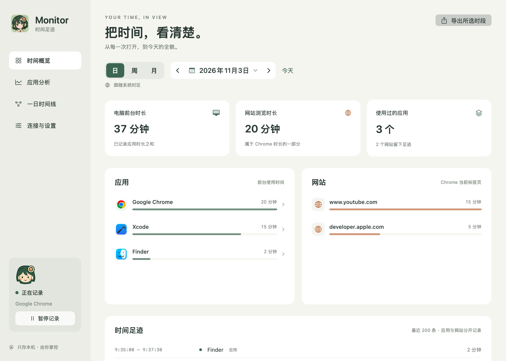
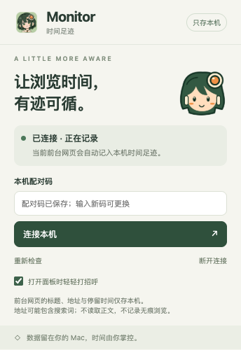
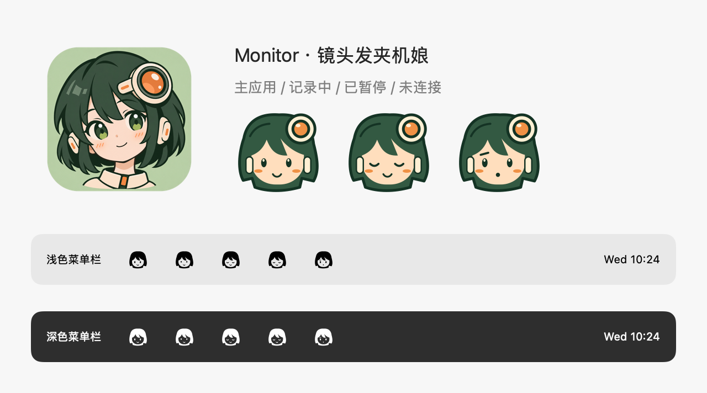

<p align="center">
  
</p>

# Monitor · 时间足迹

**把时间，看清楚。** 原生 macOS 时间追踪工具，配套 Chrome 扩展，用一个镜头发夹机娘陪你记录每天的应用与浏览足迹。

一个原生 macOS 应用和配套 Chrome 扩展，记录前台应用、当前网站的使用时长。数据保存在本机 SQLite 数据库，没有云服务、遥测或第三方运行时依赖。

**当前版本：0.3.0** · macOS 14+ · Chrome 120+ · Swift / SwiftUI / SQLite

- **知道时间花在哪里**：按日、周、月查看应用与网站排行，展开具体使用时段。
- **还原一天的轨迹**：自动把一天分成若干时段，看清每段主要在用什么、哪里专注、哪里碎片化、何时离开。
- **安静待在菜单栏**：点击查看今日仪表盘，关闭主窗口后继续记录，随时暂停或退出。
- **数据留在自己手中**：本机保存、JSON 导出，不要求注册账号。
- **一点陪伴感**：机娘随记录状态变换表情，暂停时闭眼。

## 界面预览



<p align="center">
  
</p>



预览截图使用测试数据，不包含真实用户的使用记录。

## 开始使用

要求：macOS 14 或更新版本、Chrome 120 或更新版本，以及支持 Swift 5.9+ 的 Xcode / Command Line Tools。生成的应用适用于构建机器的处理器架构。

可从 [GitHub Releases](https://github.com/NotchL1118/Monitor/releases) 下载已构建的应用：M 系列芯片选择 `macos-arm64.zip`，Intel 芯片选择 `macos-x86_64.zip`。解压后将 `Monitor.app` 移到「应用程序」文件夹，再从「连接与设置」打开随包 Chrome 扩展目录进行安装。若还没有发布版本，可以按下面的方式从源码构建。

Release 应用目前采用 ad-hoc 签名，尚未进行 Apple Developer ID 签名和公证；首次打开可能被 macOS 拦截。确认下载来源后，可在「系统设置 → 隐私与安全性」中允许打开。

仓库提供源码与图标资源；`dist/` 是本机生成目录，不随源码提交。克隆后先构建：

```bash
git clone https://github.com/NotchL1118/Monitor.git
cd Monitor
./scripts/build.sh
open dist/Monitor.app
```

随后连接浏览器扩展：

1. 打开 `dist/Monitor.app`。可以先把它移到「应用程序」文件夹，再开始使用。
2. 在 Chrome 地址栏输入 `chrome://extensions`，开启右上角的「开发者模式」。
3. 点击「加载已解压的扩展程序」，选择本项目的 `ChromeExtension` 文件夹。应用的「连接与设置」页也可以在 Finder 中显示随应用附带的扩展文件夹。
4. 在 Monitor 的「连接与设置」中点击「复制配对码」。
5. 点击 Chrome 工具栏中的 Monitor 扩展，粘贴配对码，点击「连接本机」。建议将扩展固定到工具栏。
6. 打开普通网页并浏览约 10 秒，再查看 Monitor 的网站统计。

加载后请保留扩展文件夹的位置；移动文件夹后需在 Chrome 中重新加载。移动应用之前，优先使用项目中的独立 `ChromeExtension` 文件夹。

Monitor 启动后打开主窗口并显示 Dock 图标；关闭主窗口后隐藏 Dock 中的运行图标，仍在后台记录。再次打开主窗口时 Dock 图标恢复，最小化窗口时也会保留。顶部状态栏图标始终保留：单击查看今日仪表盘，右键打开控制面板，进入时间概览、连接与设置、暂停／继续或退出。第一版不自动设置开机启动；需要时可在 macOS 的「登录项」中自行添加应用。

## 功能与记录范围

- 机娘视觉：应用图标采用镜头发夹机娘，菜单栏与 Chrome 工具栏使用适合小尺寸的简化头像。暂停或锁屏时机娘闭眼，记录异常时显示疑惑表情。
- 已有 Chrome 扩展请在 `chrome://extensions` 点击重新加载，更新到 **0.3.0**；原有配对保留。连接状态表情会在下次同步或点击「重新检查」后更新。

- 应用：记录当前前台应用的名称、标识和起止时间，后台运行不计时。
- 网站：记录前台 Chrome 普通窗口中当前标签页的域名和起止时间。记录页面标题、完整地址与停留时段，保留子域名；去除网址中的用户名和密码。地址含查询参数及片段，可能包含搜索词。超过 8 KB 的地址仅记录域名，标题最多保存 1 KB UTF-8 文本。
- 按日、周或月查看排行和时间线，也可导出所选时段的 JSON 记录。周从周一开始。
- 左侧「应用分析」为独立页面，点击概览中的应用会自动跳转并选中该应用。查看详细使用时段，与上方日／周／月和日期选择同步。日视图展示每小时用量曲线及实际时段，可放大有记录的时间；周／月展示每日趋势，点击日期查看当天明细。详情读取所选范围内的全部记录，不受首页最近 200 条限制。
- 左侧「一日时间线」先给出全天概览：上方是自动划分的时段色带（颜色为该时段的主要应用，斜纹表示离开），下方是当天前 5 个应用各占一行的使用泳道，悬停可看任意时刻在用的应用。下面按时间列出每个时段：主要应用及占比、专注／混合／碎片标签、切换次数和 Chrome 里主要看的网站；展开后可看逐次使用明细（不足 1 分钟的连续切换折叠为一行），并可跳转应用详情。读取当天全部记录。
- 时段划分规则：两次使用间隔 10 分钟以上视为离开；其余时间按 5 分钟分析，相邻时间的应用构成相近就合并为同一时段，不足 10 分钟的时段并入更相近的相邻时段；夹在两次离开之间、不足 2 分钟的零星使用并入离开。划分只用于显示，不改写数据库。
- 左侧「浏览器分析」独立展示所选日、周、月的 Chrome 前台网页记录。顶部给出网页总时长（与上一周期同一时段对比）、网站数、平均单次停留和最长连续停留。排行可按停留时长或访问次数查看网站和具体页面；选中网站后可看它的子域名、时段分布、旗下页面和每次停留的起止时间。点击「浏览时段」图中的柱子，排行和浏览记录只统计该时段。「浏览记录」按 Chrome 使用时段列出看过的每个网页，可搜索标题或网址、只看某个网站或隐藏 1 分钟以内的访问。网站依据随应用打包的 [Public Suffix List](https://publicsuffix.org/list/) 合并子域名；每段连续的前台网页记录算一次访问。仅有域名的历史记录仍计入网站排行。页面标题中的邮箱地址和验证码只在显示时隐藏，数据库和导出保留原文。
- 浏览时段图按小时或日期展示网页使用量，点击柱子可查看当时各网站的时长。「按 Chrome 使用时段查看」保留紧凑清单和时段轨迹。应用分析里的 Chrome 与其他软件一样，只展示应用前台用量和使用时段。
- 「连接与设置 → 时间与时区」可选择跟随系统或北京时间（固定 UTC+8）。日期范围、日历、应用详情和菜单栏仪表盘统一使用该时区，设置在本机保存。
- 暂停／继续记录；确认后清空所有历史记录。
- 锁屏、显示器休眠、系统休眠、切换登录会话时停止计时。
- 菜单栏常驻，约每 5 秒保存一次，应用退出前刷新。

**网站时长是 Chrome 应用时长的一部分，不能与应用总时长相加。** 应用和网站是两个统计维度。

统计的是「前台停留时长」，不是对注意力的检测。看视频或阅读时没有键鼠输入，仍会继续记录。后台播放、画中画等不是前台标签页的活动，不计入网站时长。第一版支持标准版 Google Chrome（`com.google.Chrome`）；其他浏览器和 Chrome Beta/Canary 尚未适配。

## 数据与权限

数据位置：

```text
~/Library/Application Support/Monitor/
  activity.sqlite        使用记录
  activity.sqlite-wal    SQLite 写前日志（运行时可能存在）
  activity.sqlite-shm    SQLite 共享内存（运行时可能存在）
  pairing-token          本机配对码
```

目录权限设为仅当前用户可访问；配对码文件权限为 `0600`。暂停状态存储在应用的本机偏好设置中。数据库没有额外加密，系统账户及磁盘的保护仍由 macOS 提供。

原生应用不需要屏幕录制、辅助功能或键盘监听权限。应用图标直接读取本机应用，不向网站请求 favicon。

Chrome 扩展权限：

| 权限 | 用途 |
| --- | --- |
| `tabs` | 获取当前标签页标题、地址及域名；不读取正文 |
| `storage` | 在 `chrome.storage.local` 保存配对码，不使用 Chrome 同步 |
| `alarms` | 定期唤醒 Manifest V3 后台 worker，更新连接状态 |
| `http://127.0.0.1/*` | 与本机 Monitor 通信；代码和 CSP 将地址固定为端口 `47821` |

无痕模式被禁用，浏览器内部页面、文件页面和非 HTTP(S) 页面不计入网站记录。Chrome 应用的前台时长仍包括这些窗口。扩展不注入页面脚本，不读取正文，不记录键盘输入，也不上传浏览记录。

## 本机通信与计时边界

原生应用监听 **`127.0.0.1:47821`**，不监听局域网接口。扩展在切换标签页、页面导航、窗口焦点变化时发送快照，并每 30 秒通过 Chrome alarm 更新。请求包含本机随机配对码，服务端同时校验 Host 和浏览器 Origin。

```text
POST /v1/activity
Authorization: Bearer <本机配对码>
Content-Type: application/json

{"domain":"example.com","focused":true,"url":"https://example.com/read?id=1","title":"示例页面"}
```

兼容旧版仅含域名的请求；新字段由服务端校验协议、域名一致性和长度。请求中的域名由服务端再次校验；时间戳由原生应用生成。`GET /v1/status` 也需要配对码；没有返回浏览历史的 HTTP 接口。请求体最多 64 KB（含 JSON 转义），头部最多 8 KB，连接有超时及并发上限。

- 网站只在原生应用确认前台应用为 Chrome 时累积；后台标签页不会被重复计入。
- 扩展失联后，最后的网站上下文最多保留 75 秒，之后停止网站计时；Chrome 应用计时继续。突然断开时可能存在至多该窗口内的误差。
- 解锁、唤醒后重新等待扩展更新；如果没有触发标签页或焦点事件，网站计时通常在下一次 30 秒 alarm 后恢复。Chrome 的系统调度可能进一步延迟 alarm。
- 应用关闭期间不记录，也不补记。异常退出最多可能丢失最近约 5 秒。
- 后台运行时关闭 App Nap，保证约 5 秒一次的采样不被系统限流。采样间隔异常超过 60 秒时丢弃该段，避免把休眠或挂起时间误计为使用时长。
- 展示时合并短暂切换：离开某应用不足 30 秒又回来（如瞄一眼消息、截图），应用详情显示为同一段，并标注「含 N 次短暂切换」。累计时长、每小时曲线和导出仍按原始记录计算，数据库不改写。
- 日统计按所选时区的日历边界裁剪，跨午夜的会话分别归入两天，系统时区模式支持夏令时。切换展示时区会改变历史记录的按日归属，不改写原始时间戳或实际使用时长。JSON 导出的范围跟随所选时区，时间戳仍为 ISO 8601 UTC，方便其他工具读取。
- 锁屏信号同时使用系统会话、显示器休眠通知以及 macOS 的分布式锁屏通知；后者不是稳定的公开 API，未来系统升级需要复查。

## 从源码构建

需要 Xcode 或支持 Swift 5.9+ 的开发工具。没有第三方 Swift 包，也不需要 `npm install`；运行插件测试时需要 Node.js 18 或更新版本。

```bash
./scripts/build.sh
open dist/Monitor.app
```

构建脚本会生成 release 版本、应用图标、随包扩展及本机 ad-hoc 签名。该签名适用于本机试用；面向其他机器正式分发仍需 Developer ID 签名与公证。

品牌资源：`Resources/Brand/app-icon-source.png` 为生成的 A 方案插画，`scripts/make-icon.swift` 导出带标准透明边距的应用图标；`Sources/Monitor/MascotArtwork.swift` 是小尺寸头像和表情的共享绘制源，`scripts/make-brand-assets.swift` 生成 Chrome 使用的 PNG。每次构建会重新生成并打包所有尺寸。生成提示词保存在 `Resources/Brand/generation.json`。

```bash
./scripts/test.sh
```

测试覆盖计时切换、暂停／恢复、休眠间隔、失联过期、跨天和夏令时、SQLite 持久化、HTTP 鉴权、数据库升级、同域页面切换、页面信息校验及扩展连接流程。原生集成测试会使用临时数据库、启动本机端口并渲染测试数据界面，因此需要桌面会话，且测试时应先退出正式的 Monitor。截图输出在 `.build/qa/dashboard.png`。

另有可选的真实浏览器测试 `scripts/test-chrome.mjs`：设置 `PLAYWRIGHT_MODULE_PATH` 为本机已有的 Playwright 模块路径、`CHROME_TEST_EXECUTABLE` 为 Chrome for Testing 可执行文件路径，然后运行 `node scripts/test-chrome.mjs`。它使用临时浏览器配置及本地模拟网页，验证扩展加载、配对、页面切换和后台标签页排除，不读取或修改日常 Chrome 配置。

源码结构：

```text
Sources/Monitor/         SwiftUI 界面、macOS 生命周期、前台采集、本机服务
Sources/MonitorCore/     计时模型、SQLite 存储、HTTP 解析
ChromeExtension/        Manifest V3 扩展和连接面板
Tests/                  Swift 单元及原生集成测试
ChromeExtension/tests/  扩展逻辑测试（Node 内置测试器）
scripts/                构建、图标生成及测试脚本
Resources/              应用信息、图标插画与品牌资源
docs/images/            README 使用的测试数据截图
```

## 自动构建与发布

GitHub Actions 的 **Build and Release** 工作流会在向 `main` 提交、创建或更新 PR、推送 `v*` 标签时运行，也支持在 Actions 页面手动运行。Apple Silicon 和 Intel 两种架构分别运行 Swift 逻辑测试、本机 HTTP / 数据库集成测试和 Chrome 扩展测试，测试通过后构建 release 应用，并验证签名和 ZIP 解压后的应用包。

GitHub 托管 macOS runner 的 Metal 渲染环境不可靠，工作流显式设置 `MONITOR_SKIP_UI_TESTS=1`：5 项窗口 / 渲染测试报告为 skipped，集成测试仅跳过截图，继续验证全部数据和通信行为。本机默认运行完整测试；也可用 `MONITOR_SKIP_UI_TESTS=1 ./scripts/test.sh` 复现 CI 测试模式。

普通分支构建的应用 ZIP 和校验文件保存在工作流的 **Artifacts** 中，保留 14 天；启用界面测试时生成的截图保留 7 天。手动选择分支运行只生成 Artifacts，选择版本标签运行则会进入发布流程。

发布时，先更新 `Resources/Info.plist` 中的 `CFBundleShortVersionString` 和 `CFBundleVersion`，同步 README 版本说明；若改动了扩展，也更新 `ChromeExtension/manifest.json` 中的版本。提交并推送代码后，再创建与应用版本完全一致的标签。例如应用版本为 `0.3.1`：

```bash
git tag v0.3.1
git push origin v0.3.1
```

两种架构全部测试、构建成功后，工作流会自动创建 GitHub Release，上传 `Monitor-0.3.1-macos-arm64.zip`、`Monitor-0.3.1-macos-x86_64.zip` 和 `SHA256SUMS.txt`，并生成更新说明。标签与应用版本不一致会失败，不会发布。附件全部上传成功后才公开 Release；失败后可重新运行工作流继续未完成的草稿，已公开的 Release 不会被覆盖。

工作流使用 GitHub 自带的 `GITHUB_TOKEN`，仅发布任务需要 `contents: write`，无需额外配置令牌。尚未配置 Developer ID 证书或公证凭据。运行环境使用 [GitHub 标准 macOS runner](https://docs.github.com/en/actions/reference/runners/github-hosted-runners)。

本机也可以生成相同格式的当前架构安装包：

```bash
./scripts/package-release.sh
```

输出位于 `dist/release/`；下载后在 ZIP 和校验文件所在目录运行 `shasum -a 256 -c SHA256SUMS.txt` 可验证 Release 附件。本机或 Actions Artifacts 中的单架构校验文件名为 `<ZIP 文件名>.sha256`，可用同一命令替换文件名进行验证。

## 常见问题

- **只有 Chrome 应用时间，没有网站时间**：确认扩展已配对，在普通 Chrome 窗口打开 HTTP(S) 网页，等待几秒；在扩展中点击「重新检查」。
- **连接失败**：保持 Monitor 运行，检查应用「连接与设置」中的本机服务状态。端口 `47821` 被其他进程占用时，应用统计仍可运行，网站连接会报错。
- **配对码不匹配**：从当前运行的 Monitor 重新复制配对码并连接。配对码从不随应用构建打包。
- **网站时间比 Chrome 时间少**：扩展尚未连接、浏览内部页面或无痕窗口、启动／唤醒等待新状态都可能造成差值，这是预期行为。
- **删除历史**：在「连接与设置」中清空；若需完全移除，在退出应用后删除上面的数据目录，并移除 Chrome 扩展。清空历史不会删除已手动导出的文件或系统备份。

## 实现参考

- [NSWorkspace：前台应用及系统通知](https://developer.apple.com/documentation/appkit/nsworkspace)
- [Chrome tabs API](https://developer.chrome.com/docs/extensions/reference/api/tabs)
- [Chrome alarms API](https://developer.chrome.com/docs/extensions/reference/api/alarms)
- [Chrome 扩展权限](https://developer.chrome.com/docs/extensions/develop/concepts/declare-permissions)
